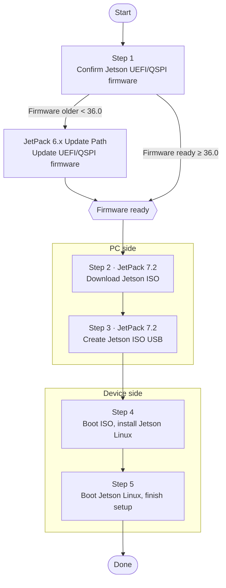

# Flash JetPack 7 (ISO Installer)

Starting with **JetPack 7.2 (Jetson Linux r39.2, based on Ubuntu 24.04)**, NVIDIA transitioned Jetson Orin Nano / NX installation to a **Jetson ISO bootable USB installer** that writes the OS onto an NVMe SSD (or a microSD card on the Official Developer Kit). **Standalone SD card images are no longer provided**, and an Ubuntu host with SDK Manager is no longer required for routine installations.

This guide covers the USB ISO installation workflow alongside compatibility notes for KYtech carrier boards (`C1901`, `C1902`, `C1902 V2`, `C1903`, `C2401`) and **SUPER mode**.

::: warning Prerequisite: JetPack 6.x-Generation Firmware Required
Installing JetPack 7.2 via the ISO USB installer requires **JetPack 6.x-generation UEFI/QSPI firmware (`36.0` or newer)** already flashed in the module's onboard QSPI memory.

- If your module's UEFI firmware is **`≥ 36.0`**, follow this guide directly.
- If your firmware is **`< 36.0`** (for example, JetPack 5 firmware or an uninitialized factory module), you must **flash JetPack 6.x first** to upgrade QSPI firmware to `36.x` before installing JetPack 7. See [Flash the Official Developer Kit](/en/flashing-guide/devkit-flashing) or your carrier board's guide ([C1901](/en/flashing-guide/c1901-flashing), [C1902 / V2](/en/flashing-guide/c1902-flashing), [C1903](/en/flashing-guide/c1903-flashing), [C2401](/en/flashing-guide/c2401-flashing)).
:::

## Scope

- **Modules**: Jetson Orin Nano (4GB / 8GB), Jetson Orin NX (8GB / 16GB)
- **Release**: JetPack 7.2 (L4T r39.2, Ubuntu 24.04)
- **Carrier Boards**: NVIDIA Official Developer Kit and KYtech `C1901`, `C1902`, `C1902 V2`, `C1903`, and `C2401` (third-party boards also require UEFI firmware `≥ 36.0` beforehand, plus post-install device-tree/driver setup where applicable).

## Overall Flow

The workflow consists of **verifying firmware**, **creating the bootable USB on any PC** (Windows, macOS, or Linux), and **booting the installer on the Jetson device**. `Step 1` through `Step 5` in the diagram below correspond directly to Sections `1` through `5`:



## 1. Confirm the Current Firmware Version

Before creating the USB installer, verify that the module's UEFI/QSPI firmware version is **`≥ 36.0`** using any of the following methods:

1. **With a Monitor (Recommended)**: Connect a monitor to your board's video port (DisplayPort on the Official Developer Kit and `C1902 / V2`, standard HDMI on `C1901 / C1903`, Mini HDMI on `C2401`) and attach a USB keyboard. Power on and press `Esc` repeatedly at the NVIDIA splash screen to open the UEFI setup menu and read the firmware version at the top.
2. **Headless Serial Console**: Connect a 3.3V USB-to-TTL serial adapter to the board's debug UART, open a serial terminal at **`115200 8N1` (no flow control)** using **crossed `TX / RX` wiring** (adapter `TXD` → board `RXD`, adapter `RXD` → board `TXD`, `GND` → `GND`; **never connect `VCC / 5V`**), power on, and press `Esc` repeatedly to inspect the UEFI menu:
   - **Official Developer Kit / `C1901` / `C1902` / `C1902 V2`**: Connect to the 12-pin Button Header (`Pin 3 = UART2_RXD`, `Pin 4 = UART2_TXD`, `Pin 7 = GND`).
   - **`C1903` / `C2401`**: Connect to the dedicated 4-pin GH1.25 **`UART DEBUG` (`UART2 Debug`)** port (`Pin 1 = GND`, `Pin 2 = RX`, `Pin 3 = TX`; leave `Pin 4 = 5V` unconnected).
3. **From a Running Jetson OS**: If the board already boots Linux, run `cat /etc/nv_tegra_release` or `sudo nvbootctrl dump-slots-info` to verify that it is already on R36.x (JetPack 6) or newer.


*Checking the UEFI firmware version in the UEFI setup menu (must be `≥ 36.0`)*


*Headless check on 12-pin boards: USB-to-TTL serial adapter connected to the Button Header (`RXD / TXD` crossed + `GND`)*

::: warning Do Not Skip the JetPack 6.x Upgrade on Older Firmware
If the firmware version is older than `36.0`, the board cannot boot the JetPack 7 ISO installer. Complete a JetPack 6.x flash first as noted in the Prerequisite box above.
:::

## 2. Prepare Hardware and Download the Jetson ISO

Prepare the following items:

| Item | Specification & Notes |
| --- | --- |
| **Jetson ISO Image** | File matching `jetsoninstaller-r39.2.0-*-arm64.iso` (L4T r39.2) |
| **USB Flash Drive** | `≥ 16 GB`, used to create the bootable ISO installer (all existing data on the USB drive will be erased) |
| **Target System Storage** | **Single-sided NVMe SSD** (strongly recommended; required for Orin NX, production Orin Nano, and all KYtech carrier boards) or **microSD card** (64GB UHS-1+, supported only on the Orin Nano Developer Kit module) |
| **Balena Etcher** | Cross-platform USB image writer (Windows, macOS, Linux) |

Download the **Jetson ISO (r39.2)** installer image from the official NVIDIA JetPack downloads page (expand JetPack 7.2 / Jetson Linux r39.2 and download `jetsoninstaller-r39.2.0-*-arm64.iso`):

- Official download page: <https://developer.nvidia.com/embedded/jetpack/downloads>

Target storage options:


*microSD card (64GB UHS-1 or larger — Official Orin Nano Developer Kit module only)*


*Single-sided NVMe SSD (recommended for speed and reliability; required on Orin NX and third-party carrier boards)*

## 3. Create the Bootable ISO USB Drive

1. Download and launch **[Balena Etcher](https://etcher.balena.io/)** on your PC.
2. Click **Flash from file** and select the downloaded `jetsoninstaller-r39.2.0-*-arm64.iso`.
3. Insert your USB flash drive and click **Select target** to choose it.
4. Click **Flash!** to write and verify the image, then safely eject the USB drive.


*Balena Etcher interface*


*Select the Jetson ISO image and target USB drive, then click Flash*

## 4. Boot from the ISO USB and Install Jetson Linux

1. With power disconnected, install the target storage (**NVMe SSD** or microSD card), insert the **bootable ISO USB drive**, and connect your monitor, USB keyboard, and power supply.
2. Power on the board and follow the on-screen installation flow:
   - When prompted to confirm the **UEFI capsule firmware update**, press **`Y`** within the ~30-second countdown.
   - The system performs a **dual-pass UEFI capsule update** and reboots automatically several times — **this is normal; do not disconnect power or remove the USB drive**.
   - At the **GRUB menu**, select **`Install Jetson ISO r39.2`** and press `Enter`.
   - Select your target storage device (**`NVMe`** or **`microSD`**).
   - Confirm the installation (**this erases all existing data on the target storage drive**).
3. Once installation finishes, **unplug the ISO USB drive** and reboot so the system boots from the target storage drive.

## 5. Complete Initial Setup and Enable SUPER Mode

On first boot from the target drive, follow the Ubuntu 24.04 initial setup prompts (language, time zone, keyboard layout, username, and password). Once on the desktop, if your carrier board supports **SUPER mode** for the installed module, you can switch to maximum performance from the top bar:

1. Click the active power profile indicator in the top-right corner of the Ubuntu desktop (typically `25W`).
2. Open the **Power Mode** submenu.
3. Select **`MAXN SUPER`** (or `25W` / `40W` depending on your thermal envelope).


*Selecting `MAXN SUPER` from the desktop power menu*

::: warning SUPER Mode Profiles and Carrier Compatibility
- **Jetson Orin Nano**: Standard mode offers `7W / 15W`; SUPER mode unlocks **`25W`** and **`MAXN SUPER`** (supported on the Official Developer Kit and all KYtech carrier boards).
- **Jetson Orin NX**: Standard mode offers `10W / 15W / 25W`; SUPER mode unlocks **`40W`** and **`MAXN SUPER`**. **Only `C1902 (V1.1+)`, `C1902 V2`, and `C1903` support Orin NX `40W / MAXN SUPER`** — on the Official Developer Kit, `C1901`, and `C2401`, keep Orin NX at `25W` or lower.
:::

On third-party carrier boards, also check [Orin Nano / NX USB Configuration](/en/orin-nano-series/usb-config) and [Network Card Driver](/en/orin-nano-series/network-driver) for JetPack 7.2 device-tree and peripheral driver notes.

## Other Flashing Methods (Optional)

While the USB ISO installer is NVIDIA's recommended path for JetPack 7.2, host-based flashing remains supported for **upgrading boards with firmware `< 36.0`**, **headless setups**, and **batch production flashing** (requires an **Ubuntu 22.04 or 24.04 Desktop** host — Ubuntu 20.04 is not supported for JetPack 7):

### SDK Manager (Direct Flash)

Use NVIDIA SDK Manager's **Direct Flash** workflow on an Ubuntu 22.04 / 24.04 host to update QSPI firmware and flash Jetson Linux in a single run. For host setup, see [Install Ubuntu VM and SDK Manager](/en/flashing-guide/ubuntu-sdkmanager).

### Command-Line initrd Flash (Third-Party Boards / SUPER Firmware)

To flash NVMe external storage with SUPER firmware directly from the command line (after generating the `JetPack_7.2_...` cache directory once via SDK Manager):

1. Put the board into Force Recovery mode and connect it to the Ubuntu host over USB Type-C:
   - **Official Developer Kit / `C1901` / `C1902 (V1.x)`**: Power off, short **`FC REC` (Pin 10)** and **`GND` (Pin 9 / 11)** on the 12-pin header with a jumper cap, connect Type-C, and apply power (remove the jumper once detected).
   - **`C1902 V2` / `C1903` / `C2401`**: Power off, connect the Type-C cable first, then **press and hold the onboard `REC` button** while applying power (if using rear DIP switch 3 on `C1903` / `C2401`, set switch 3 back to `OFF` once detected).
2. Close any running SDK Manager window, navigate to your `Linux_for_Tegra` directory (`JETSON_ORIN_NANO_TARGETS` or `JETSON_ORIN_NX_TARGETS`), and run:

**Run on the Ubuntu host terminal:**

```bash
cd ~/nvidia/nvidia_sdk/JetPack_7.2_Linux_JETSON_ORIN_NANO_TARGETS/Linux_for_Tegra
sudo ./tools/kernel_flash/l4t_initrd_flash.sh --external-device nvme0n1p1 \
  -c tools/kernel_flash/flash_l4t_t234_nvme.xml -p "-c bootloader/generic/cfg/flash_t234_qspi.xml" \
  --showlogs --network usb0 jetson-orin-nano-devkit-super internal
```

::: tip Identical Flags to JetPack 6.2
Aside from changing the cache path to `JetPack_7.2_...`, all command arguments (including `jetson-orin-nano-devkit-super`) are identical to JetPack 6.2. For full step-by-step details, see [2. Flash SUPER Firmware from the Command Line](/en/flashing-guide/c1902-flashing#_2-flash-super-firmware-from-the-command-line) in [Flash C1902 / C1902 V2](/en/flashing-guide/c1902-flashing), [Flash the C1903](/en/flashing-guide/c1903-flashing), or [Flash the C2401](/en/flashing-guide/c2401-flashing).
:::

## Troubleshooting

- **Stuck on firmware update / repeated automatic reboots**: The dual-pass UEFI capsule update reboots multiple times while updating boot slots — this is normal; never cut power or unplug the USB drive mid-update.
- **No Install option in GRUB / cannot boot the ISO USB**: Confirm that the board's UEFI firmware is **`≥ 36.0`** (see Section 1); older firmware must be upgraded via JetPack 6.x first.
- **Target storage drive not detected**: Reseat the NVMe SSD (or microSD card on the Official Developer Kit) with power disconnected; use a **single-sided NVMe SSD** in M.2 Key M slots.

---

> Reference: [NVIDIA Jetson Orin Nano Developer Kit — Quick Start Guide](https://docs.nvidia.com/jetson/orin-nano-devkit/user-guide/latest/quick_start.html)
