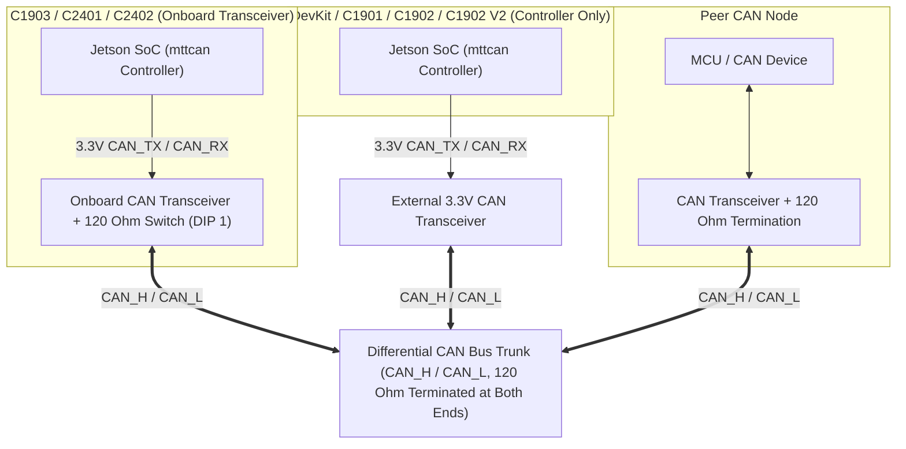

# Other Peripherals

This guide covers how to configure and test **UART**, **SPI**, **I2C**, **CAN Bus**, and **RTC (Real-Time Clock)** interfaces on Jetson Orin series boards. Unless otherwise stated, run all commands in the **Jetson board terminal**.

::: warning 3.3V Logic Level Notice
All **UART, SPI, I2C, and GPIO** signal pins exposed on the 40-pin expansion header, 30-pin expansion connector, and GH1.25 peripheral connectors operate at **3.3V logic levels** (even on connectors that also carry a `5V` power pin, the signal pins are not 5V-tolerant). Verify external device voltage levels before wiring and never drive 5V logic directly into 3.3V signal pins.
:::

## 1. UART Interface

General-purpose UART device nodes and physical connectors vary across JetPack versions and carrier boards:

- **Device node by JetPack version**: The default general-purpose UART on the 40-pin header (Pin 8 `UART1_TX`, Pin 10 `UART1_RX`) maps to **`/dev/ttyTHS1` on JetPack 6 / 7**, and to **`/dev/ttyTHS0` on JetPack 5** (check with `ls /dev/ttyTHS*`). The examples below use `/dev/ttyTHS1` on JetPack 6.
- **Connector location by carrier board**:
  - **Official DevKit / C1901 / C1902 / C1902 V2**: Exposed on **Pin 8 (`UART1_TX`)** and **Pin 10 (`UART1_RX`)** of the 40-pin expansion header (use Pin 6 or Pin 9 for `GND`).
  - **C1903 / C2402**: No 40-pin header; general-purpose UARTs are exposed on dedicated **4-pin GH1.25** connectors (`UART0` and `UART1` on C1903, `UART1` on C2402; pinout: `1: GND, 2: RX, 3: TX, 4: 5V`).
  - **C2401**: General-purpose UART is exposed on the rear **30-pin expansion header**, plus a dedicated 4-pin GH1.25 `UART1` connector (**Note**: `UART1` on C2401 is routed from M.2 Key E and requires installing the matching device tree before use; see [C2401 Introduction](/en/c2401/c2401)).

### 1.1 Test UART with CuteCom

`CuteCom` is a cross-platform graphical serial terminal for sending and receiving serial data interactively. Install `CuteCom` on the Jetson board:

```bash
sudo apt update
sudo apt install -y cutecom
```


Perform a UART loopback test as follows:

1. Use a **jumper wire (DuPont wire)** to short **Pin 8 (`UART1_TX`)** and **Pin 10 (`UART1_RX`)** on the 40-pin header (or `TX` and `RX` on the corresponding GH1.25 UART connector).
2. Grant serial port permissions (choose either method):

   Grant temporary read/write access for the current boot session:

   ```bash
   sudo chmod 666 /dev/ttyTHS1
   ```

   Or add your user to the `dialout` group for persistent access (log out and back in, or reboot, for the group change to take effect):

   ```bash
   sudo usermod -aG dialout $USER
   ```

3. Launch `CuteCom`, select `/dev/ttyTHS1` (or `/dev/ttyTHS0` on JetPack 5) in the `Device` field, and click **Open**:

   

4. Enter text in the `Input` box and press `Enter`. The echoed data appears in the receive pane below:

   

### 1.2 Use UART with Python

1. Ensure your user has permission to access `/dev/ttyTHS1` (via `sudo chmod 666 /dev/ttyTHS1` or membership in the `dialout` group).
2. Install the `pyserial` library:

   ```bash
   python3 -m pip install pyserial
   ```

3. Keep `TX` and `RX` shorted together, then save and run the following Python test script (change `PORT` to `"/dev/ttyTHS0"` on JetPack 5):

   ```python
   import serial
   import time

   PORT = "/dev/ttyTHS1"
   BAUDRATE = 115200
   ENCODING = "UTF-8"
   MESSAGE = "hello, jetson\r\n"

   try:
       with serial.Serial(PORT, BAUDRATE, timeout=2) as se:
           print(f"Serial port {PORT} opened: {se.is_open}")
           while True:
               se.write(MESSAGE.encode(ENCODING))
               print(f"Sent: {MESSAGE.strip()}")
               try:
                   line = se.readline().decode(ENCODING).strip()
                   if line:
                       print(f"Received: {line}")
               except Exception as e:
                   print(f"Read error: {e}")
               time.sleep(1)
   except serial.SerialException as e:
       print(f"Serial error: {e}")
   except KeyboardInterrupt:
       print("\nExit by user.")
   ```

   Expected output when loopback communication succeeds:

   

## 2. SPI Interface

::: warning Prerequisite: Enable SPI Pinmux on JetPack 6 / 7
Under default **JetPack 6 / 7** firmware, SPI pins on the 40-pin header are set to `unused` by default. On carrier boards with a 40-pin header (Official DevKit, C1901, C1902, C1902 V2), follow [40-pin Expansion Header (Jetson-IO)](/en/orin-nano-series/expansion-header) to run `sudo /opt/nvidia/jetson-io/jetson-io.py`, enable **`spi1`** (labeled `SPI0` on the silkscreen), and reboot before running the tests below.

On **C1903 / C2402**, SPI is exposed via the **6-pin GH1.25 `SPI0`** connector (`Pin 3: MOSI`, `Pin 4: MISO`); on **C2401**, it is exposed on the **30-pin expansion header**. Boards without a 40-pin header do not use the Jetson-IO 40-pin menu and require the board-specific device tree.
:::

Load the `spidev` kernel module and verify that the SPI drivers are active:

```bash
sudo modprobe spidev
lsmod | grep -i spi
```

Expected output:

```text
spidev                 28672  0
spi_tegra114           32768  0
```

### 2.1 SPI Communication with C/C++

Using `SPI0` (device node `/dev/spidev0.0`) for a loopback test, **use a jumper wire (DuPont wire) to short Pin 19 (`SPI0_MOSI`) and Pin 21 (`SPI0_MISO`) on the 40-pin expansion header** (on the C1903 / C2402 6-pin GH1.25 `SPI0` connector, short Pin 3 `MOSI` and Pin 4 `MISO`).

::: danger Never Short Pin 19 to Pin 20 (GND)
On the dual-row 40-pin header, **Pin 19 (`SPI0_MOSI`) and Pin 21 (`SPI0_MISO`) are adjacent pins on the odd-numbered row**, whereas **Pin 20 across on the even-numbered row is `GND`!** Double-check the pin numbers before wiring — **never short Pin 19 to Pin 20**, as doing so shorts the `MOSI` output directly to ground, causing all-zero (`0x00`) reads and risking pin damage.
:::

1. Clone and compile `spidev-test`:

   ```bash
   git clone https://github.com/rm-hull/spidev-test
   cd spidev-test
   gcc spidev_test.c -o spidev_test
   ```

2. Run the SPI loopback test:

   ```bash
   sudo ./spidev_test -D /dev/spidev0.0 -s 100000 -p "\x11\x22\x33" -v
   ```

   When both `TX` and `RX` lines show `11 22 33`, SPI loopback communication is working properly:

   ```text
   spi mode: 0x0
   bits per word: 8
   max speed: 100000 Hz (100 KHz)
   TX | 11 22 33 __ __ __ __ __ __ __ __ __ __ __ __ __ __ __ __ __ __ __ __ __ __ __ __ __ __ __ __ __  | ."3
   RX | 11 22 33 __ __ __ __ __ __ __ __ __ __ __ __ __ __ __ __ __ __ __ __ __ __ __ __ __ __ __ __ __  | ."3
   ```

### 2.2 SPI Communication with Python

1. Install the `spidev` Python package:

   ```bash
   python3 -m pip install spidev
   ```

2. Keep `MOSI` and `MISO` shorted, save the following script as `test_spi.py`, and run it (use `sudo python3 test_spi.py` if your user does not have direct permission on `/dev/spidev0.0`):

   ```python
   import spidev
   import time

   spi = spidev.SpiDev()
   spi.open(0, 0)
   spi.max_speed_hz = 1_000_000
   spi.mode = 0

   TEST_DATA = [
       [11], [22], [33]
   ]

   for data in TEST_DATA:
       resp = spi.xfer2(data)
       print(f"received: {resp}")
       time.sleep(0.1)

   spi.close()
   ```

   Run the script:

   ```bash
   python3 test_spi.py
   ```

   Expected output:

   ```text
   received: [11]
   received: [22]
   received: [33]
   ```

## 3. I2C Interface

I2C buses are exposed on each carrier board as follows:

- **Official DevKit / C1901 / C1902 / C1902 V2 (40-pin header)**: Pin 3 (`I2C1_SDA`) and Pin 5 (`I2C1_SCL`) map to Linux bus **`i2c-7`**; Pin 27 (`I2C0_SDA`) and Pin 28 (`I2C0_SCL`) map to **`i2c-1`**.
- **C1903 / C2402**: Exposed via a dedicated **4-pin GH1.25 `I2C`** connector (`1: GND, 2: SDA, 3: SCL, 4: 5V`, 3.3V logic signals).
- **C2401**: Exposed on the rear **30-pin expansion header**.

1. Install `i2c-tools`:

   ```bash
   sudo apt update
   sudo apt install -y i2c-tools
   ```

2. List all available I2C buses on the board:

   ```bash
   i2cdetect -l
   ```

   Expected output:

   ```text
   i2c-0    i2c           3160000.i2c                         I2C adapter
   i2c-1    i2c           c240000.i2c                         I2C adapter
   i2c-2    i2c           3180000.i2c                         I2C adapter
   i2c-4    i2c           Tegra BPMP I2C adapter              I2C adapter
   i2c-5    i2c           31b0000.i2c                         I2C adapter
   i2c-7    i2c           c250000.i2c                         I2C adapter
   i2c-9    i2c           NVIDIA SOC i2c adapter 0            I2C adapter
   ```

3. Scan for I2C devices on a target bus (for example, bus `7` corresponding to Pins 3 and 5 on the 40-pin header):

   ```bash
   sudo i2cdetect -y -r -a 7
   ```

   Once an I2C peripheral is properly wired (including common `GND`), its hexadecimal address (such as `3c` for a typical OLED display) appears in the scan grid.

## 4. CAN Bus

KYtech carrier boards fall into two hardware categories depending on **whether an onboard CAN transceiver is populated**. Check your exact carrier board model before wiring:

::: danger Never Connect Controller-Only Pins Directly to CAN_H / CAN_L
- **Without onboard transceiver (Official DevKit / C1901 / C1902 / C1902 V2)**: These boards expose only **3.3V logic-level `CAN_TX` and `CAN_RX` signals** from the Jetson SoC without a transceiver chip. You **must connect an external 3.3V CAN transceiver module** (such as SN65HVD230 or TJA1051) to join a CAN bus. **Never wire `CAN_TX` / `CAN_RX` directly to differential `CAN_H` / `CAN_L` bus lines**, or you will damage the Jetson module pins!
- **With onboard transceiver (C1903 / C2401 / C2402)**: These boards integrate an onboard CAN transceiver and **output differential `CAN_H` and `CAN_L` directly** on the 2-pin GH1.25 connector (and on the XT30 `2+2` connector on C2402), ready to wire directly to a CAN bus.
:::



On **C1903 / C2401 / C2402**, if the board is placed at either physical end of the CAN bus trunk, slide **DIP switch 1 (`CAN 120R`)** to **`ON`** to engage the onboard **120 Ω termination resistor**:


### 4.1 Configure and Test CAN Bus

1. Load the CAN protocol and NVIDIA `mttcan` controller kernel modules:

   ```bash
   sudo modprobe can
   sudo modprobe can_raw
   sudo modprobe mttcan
   ```

2. Install `can-utils`:

   ```bash
   sudo apt update
   sudo apt install -y can-utils
   ```

3. Configure the `can0` bitrate and bring the interface up (`10 kbps` is shown below as an example; always match the exact bitrate of peer nodes on the bus, such as `500000` for `500 kbps`, and bring the interface down before changing bitrate):

   ```bash
   sudo ip link set down can0
   sudo ip link set can0 type can bitrate 10000
   sudo ip link set up can0
   ```

4. Transmit a test CAN frame:

   ```bash
   cansend can0 123#00.00.00.00.11.11.11.11
   ```

5. Monitor incoming CAN frames (run in a second terminal or append `&` to run in the background):

   ```bash
   candump can0
   ```

### 4.2 Inspect CAN Status and Diagnose Errors

Use `ip` with `-details -statistics` to inspect the protocol-level controller state, configured bitrate, and TX/RX error counters (traditional `ifconfig` does not display CAN controller states):

```bash
ip -details -statistics link show can0
```

Expected output:

```text
6: can0: <NOARP,UP,LOWER_UP,ECHO> mtu 16 qdisc pfifo_fast state UP mode DEFAULT group default qlen 10
    link/can  promiscuity 0 minmtu 0 maxmtu 0
    can state ERROR-ACTIVE (berr-counter tx 0 rx 0) restart-ms 0
          bitrate 10000 sample-point 0.875
          tq 6250 prop-seg 6 phase-seg1 7 phase-seg2 2 sjw 1
          clock 50000000
    RX: bytes  packets  errors  dropped missed  mcast
    16         2        0       0       0       0
    TX: bytes  packets  errors  dropped carrier collsns
    0          0        0       0       0       0
```

At the CAN protocol level, the `can state` field indicates one of three states:

- **`ERROR-ACTIVE` (Normal)**: Healthy operating state. The node transmits and receives normally, and sends active error frames when bus errors are detected.
- **`ERROR-PASSIVE` (Warning)**: Entered when the RX or TX error counter (`berr-counter tx/rx`) exceeds `127` (typically caused by mismatched bitrates, missing 120 Ω termination, or swapped `CAN_H` / `CAN_L` wires). The node can still communicate but only emits passive error frames to avoid disrupting healthy nodes.
- **`BUS-OFF` (Critical)**: Triggered when the transmit error counter exceeds `255`. The CAN controller isolates itself from the physical bus and halts all communication. After fixing wiring and termination, recover by cycling the interface (`sudo ip link set down can0 && sudo ip link set up can0`) or configuring automatic recovery (e.g., `restart-ms 100`).

## 5. RTC Interface

A real-time clock (RTC) keeps accurate time across power cycles using a backup coin-cell battery. Configure the hardware RTC whenever the Jetson system operates offline without NTP access and must retain wall-clock time after power loss.

::: danger Battery Connector & Polarity Warning
- The **Official NVIDIA Developer Kit does not include** a backup battery connector for power-off RTC retention. KYtech carrier boards (C1901 V1.2+, C1902, C1902 V2, C1903, C2401, C2402) provide a **3V MX1.25-2P** RTC battery header.
- Always verify positive and negative polarity markings before plugging in the battery — **never connect the battery in reverse**, as reverse polarity can damage the RTC circuit or cause battery overheating!
:::


### 5.1 Identify the Hardware RTC Device Node

Jetson Linux typically exposes multiple RTC nodes (such as the SoC's internal RTC without battery backup alongside an external or battery-backed carrier RTC, appearing as `/dev/rtc0` and `/dev/rtc1`). List the registered RTC devices first:

```bash
ls -l /sys/class/rtc/
grep . /sys/class/rtc/rtc*/name
```

Confirm which `/dev/rtcN` node corresponds to the battery-backed RTC on your carrier board (if unsure, write the time, disconnect main power for a few minutes, and check which node retains the clock). The commands and service unit below use `/dev/rtc0` as an example — **if your battery-backed RTC is `/dev/rtc1`, replace `/dev/rtc0` with `/dev/rtc1` throughout**.

### 5.2 Set Time and Write to Hardware RTC

1. Check the current system clock status:

   ```bash
   timedatectl status
   ```

2. Set your timezone and synchronize system time over the network (while internet access is available):

   ```bash
   sudo timedatectl set-timezone UTC   # replace UTC with your local timezone, e.g. America/New_York
   sudo apt update
   sudo apt install -y ntpdate
   sudo ntpdate pool.ntp.org
   ```

3. Write the calibrated system clock into the hardware RTC (in UTC):

   ```bash
   sudo hwclock --systohc --utc --rtc /dev/rtc0 --noadjfile
   ```

4. Read back the hardware RTC clock to verify:

   ```bash
   sudo hwclock --show --utc --rtc /dev/rtc0 --noadjfile
   ```

### 5.3 Automatically Restore System Time from RTC at Boot

To restore the system clock from your verified RTC node automatically on every offline boot, create a custom `systemd` unit under `/etc/systemd/system/`:

1. Create `/etc/systemd/system/hwrtc.service` (do not place custom unit files in `/lib/systemd/system/`, which is reserved for OS packages):

   ```bash
   sudo nano /etc/systemd/system/hwrtc.service
   ```

2. Add the following unit configuration (update `--rtc /dev/rtc0` if your hardware RTC uses `/dev/rtc1`):

   ```ini
   [Unit]
   Description=Synchronize System Clock from Hardware RTC
   DefaultDependencies=no
   After=systemd-modules-load.service
   Before=systemd-journald.service systemd-fsck-root.service time-sync.target sysinit.target shutdown.target
   Conflicts=shutdown.target

   [Service]
   Type=oneshot
   RemainAfterExit=yes
   ExecStart=/sbin/hwclock --hctosys --utc --rtc /dev/rtc0 --noadjfile
   RestrictRealtime=yes

   [Install]
   WantedBy=sysinit.target
   ```

3. Reload `systemd` and enable the service at boot:

   ```bash
   sudo systemctl daemon-reload
   sudo systemctl enable hwrtc.service
   ```

4. (Optional) Manual maintenance commands:

   Manually copy the hardware RTC clock to the system clock:

   ```bash
   sudo hwclock --hctosys --utc --rtc /dev/rtc0 --noadjfile
   ```

   Disable network time synchronization when deploying in a permanently offline environment:

   ```bash
   sudo timedatectl set-ntp false
   ```
