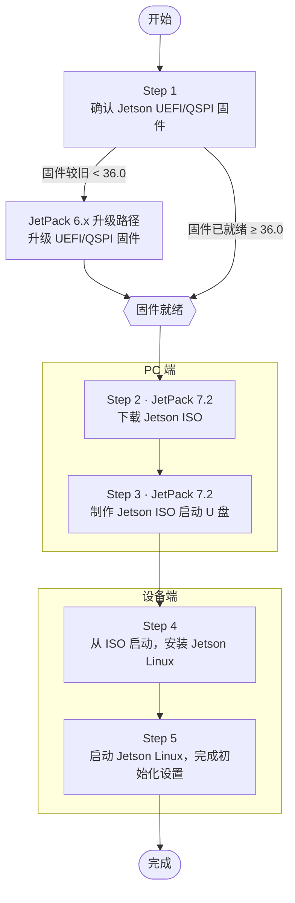

# JetPack 7 刷入系统（ISO 安装）

从 **JetPack 7.2（Jetson Linux r39.2，基于 Ubuntu 24.04）** 开始，Jetson Orin Nano / NX 的安装方式迎来了重大升级：官方主推 **Jetson ISO 启动 U 盘安装**，通过 U 盘引导标准安装器将系统写入 NVMe SSD（或官方套件的 microSD 卡），**不再提供独立的 SD 卡镜像**，也不再强制依赖 Ubuntu 宿主机上的 SDK Manager。

本页介绍这套免虚拟机的 ISO 安装流程，并补充控元科技全系载板（`C1901`、`C1902`、`C1902 V2`、`C1903`、`C2401`）的适配要点与 **SUPER 模式**说明。

::: warning 关键前提：设备必须已具备 JetPack 6.x 代固件
JetPack 7.2 的 ISO 安装器要求核心卡板载 QSPI 中已存在 **JetPack 6.x 代的 UEFI 固件（版本号 `36.0` 或更新）**。

- 如果您的设备固件版本 **`≥ 36.0`**，可直接按本页步骤通过 U 盘安装。
- 如果固件版本 **`< 36.0`**（如早期 JetPack 5 固件或全新出厂未初始化的核心卡），必须**先刷入一次 JetPack 6.x** 将 QSPI 固件升级至 `36.x`，再来安装 JetPack 7。请先参考 [官方开发者套件刷入系统](/flashing-guide/devkit-flashing) 或对应载板刷机页（[C1901](/flashing-guide/c1901-flashing)、[C1902 / V2](/flashing-guide/c1902-flashing)、[C1903](/flashing-guide/c1903-flashing)、[C2401](/flashing-guide/c2401-flashing)）完成升级。
:::

## 适用范围

- **核心卡**：Jetson Orin Nano（4GB / 8GB）、Jetson Orin NX（8GB / 16GB）
- **系统版本**：JetPack 7.2（L4T r39.2，Ubuntu 24.04）
- **适用载板**：NVIDIA 官方开发者套件，以及控元科技 `C1901`、`C1902`、`C1902 V2`、`C1903`、`C2401`（第三方载板同样需先具备 `≥ 36.0` 的 UEFI 固件，并在装完系统后按需替换对应设备树与驱动）。

## 总体流程

整个过程分为**固件确认**、**PC 端制作启动 U 盘**（Windows / macOS / Linux 均可）和**设备端引导安装**三部分，下方 `Step 1`～`Step 5` 与正文第 `1`～`5` 节一一对应：



## 1. 确认当前固件版本

在制作启动盘前，请先确认核心卡当前的 UEFI / QSPI 固件版本是否 **`≥ 36.0`**。可任选以下方式查看：

1. **连接显示器查看（推荐）**：按载板显示接口连接显示器（官方套件与 `C1902 / V2` 为 DisplayPort，`C1901 / C1903` 为标准 HDMI，`C2401` 为 Mini HDMI）并插入 USB 键盘，上电后在 NVIDIA 启动画面连续按 `Esc` 键进入 UEFI 设置菜单，在顶部查看固件版本号。
2. **调试串口无屏查看**：使用 3.3V 电平的 USB-TTL 串口模块连接载板调试串口，串口终端参数设为 **`115200 8N1`（无流控）**，注意采用 **`TX / RX` 交叉接线**（USB-TTL 的 `TXD` 接载板 `RXD`，USB-TTL 的 `RXD` 接载板 `TXD`，`GND` 接 `GND`，**切勿连接 `VCC / 5V` 供电脚**），上电后连续按 `Esc` 进入 UEFI 菜单查看：
   - **官方套件 / `C1901` / `C1902` / `C1902 V2`**：连接 12-pin Button Header（`Pin 3 = UART2_RXD`、`Pin 4 = UART2_TXD`、`Pin 7 = GND`）；
   - **`C1903` / `C2401`**：连接载板上独立的 4-pin GH1.25 **`UART DEBUG`（`UART2 Debug`）调试串口**（Pin 1 `GND`、Pin 2 `RX`、Pin 3 `TX`；请勿接 Pin 4 `5V`）。
3. **若设备已有可用系统**：也可在 Jetson 终端运行 `cat /etc/nv_tegra_release` 或 `sudo nvbootctrl dump-slots-info` 辅助确认当前是否已运行在 R36.x（JetPack 6）及以上。


*在 UEFI 设置菜单顶部确认固件版本号（需 `≥ 36.0`）*


*官方套件与 12-pin 载板无屏调试：USB-TTL 串口线连接 Button Header（`RXD / TXD` 交叉 + `GND`）*

::: warning 旧版固件请勿跳过升级
若查看到的固件版本低于 `36.0`，直接插入 JetPack 7 ISO 启动盘将无法正常引导安装器。请务必先按页首「关键前提」刷入一次 JetPack 6.x。
:::

## 2. 准备硬件与下载 Jetson ISO

请准备以下硬件与软件工具：

| 物品 | 规格与说明 |
| --- | --- |
| **Jetson ISO 镜像** | 文件名格式为 `jetsoninstaller-r39.2.0-*-arm64.iso`（L4T r39.2） |
| **U 盘** | 容量 `≥ 16 GB`，用于制作 ISO 启动安装盘（仅作安装引导介质，写入时会清空 U 盘数据） |
| **目标系统盘** | **单面 NVMe SSD**（强烈推荐；Orin NX、量产版 Orin Nano 及所有控元科技载板必选），或 **microSD 卡**（64GB UHS-1 及以上，仅限官方套件附带的 Orin Nano 核心卡） |
| **Balena Etcher** | 跨平台镜像烧录工具（支持 Windows / macOS / Linux），用于将 ISO 写入 U 盘 |

前往 NVIDIA 官方下载中心获取 **Jetson ISO（r39.2）** 镜像文件（在页面中展开 JetPack 7.2 / Jetson Linux r39.2，下载 `jetsoninstaller-r39.2.0-*-arm64.iso`）：

- 官方下载入口：<https://developer.nvidia.com/embedded/jetpack/downloads>

目标系统存储介质示意：


*microSD 卡（64GB UHS-1 及以上，仅适用于带卡槽的 Orin Nano 官方套件核心卡）*


*单面 NVMe SSD（推荐，速度与容量更优，Orin NX 与第三方载板必选）*

## 3. 制作 ISO 启动 U 盘

1. 在电脑上下载并打开 **[Balena Etcher](https://etcher.balena.io/)**。
2. 点击 **Flash from file**，选择已下载的 `jetsoninstaller-r39.2.0-*-arm64.iso`。
3. 插入 U 盘，点击 **Select target** 选中该 U 盘。
4. 点击 **Flash!** 开始写入，等待写入与校验完成后安全弹出 U 盘。


*Balena Etcher 工具界面*


*选择 Jetson ISO 镜像与目标 U 盘后点击 Flash 写入*

## 4. 从 ISO 启动并安装系统

1. 确保载板断电，装好目标系统盘（**NVMe SSD** 或 microSD 卡），将制作好的 **ISO 启动 U 盘**插入载板 USB 接口，连接显示器、USB 键盘与电源。
2. 上电开机，按屏幕提示完成自动化引导与系统安装：
   - 当屏幕出现 **UEFI 固件胶囊更新（UEFI capsule update）** 确认提示时，在 30 秒倒计时内按 **`Y`** 确认。
   - 设备将依次执行**两轮（dual-pass）UEFI 胶囊更新**，期间会自动重启数次，**属正常现象，切勿中途断电或拔出 U 盘**。
   - 更新完成后进入 **GRUB 引导菜单**，选择 **`Install Jetson ISO r39.2`** 并按回车。
   - 在安装器中选择目标存储设备（如 **`NVMe`** 或 **`microSD`**）。
   - 确认开始安装（**该操作会格式化并擦除目标存储盘上的原有数据**）。
3. 提示安装完成后，**拔掉 ISO 启动 U 盘**，按提示重启设备，系统将从目标存储盘引导启动。

## 5. 完成初始化并开启 SUPER 模式

重启进入目标系统后，按向导完成 Ubuntu 24.04 初始化配置（语言、时区、键盘布局、用户名与密码）。进入桌面后，若当前载板支持对应核心卡的 **SUPER 模式**，可在桌面顶栏切换最高性能档位：

1. 点击 Ubuntu 桌面右上角顶栏显示的当前电源模式（例如 `25W`）。
2. 选择 **Power Mode** 子菜单。
3. 切换至 **`MAXN SUPER`**（或按散热条件选择 `25W` / `40W`）。


*在桌面右上角电源模式菜单中选择 `MAXN SUPER`*

::: warning 各核心卡与载板的 SUPER 档位说明
- **Jetson Orin Nano**：标准模式仅有 `7W / 15W`，SUPER 模式下解锁 **`25W`** 与 **`MAXN SUPER`**（官方套件及控元科技全系载板均支持）。
- **Jetson Orin NX**：标准模式为 `10W / 15W / 25W`，SUPER 模式下解锁 **`40W`** 与 **`MAXN SUPER`**。注意：**仅 `C1902（V1.1+）`、`C1902 V2`、`C1903` 支持开启 Orin NX `40W / MAXN SUPER`**；官方套件、`C1901`、`C2401` 搭配 Orin NX 时请保持在 `25W` 及以下档位运行。
:::

对于第三方载板，进入系统后请继续参考 [Orin Nano / NX USB 配置](/orin-nano-series/usb-config) 与 [网卡驱动](/orin-nano-series/network-driver) 检查对应 JetPack 7.2 版本的设备树及外设驱动适配情况。

## 其他刷机方式（可选）

虽然 U 盘 ISO 安装是 JetPack 7.2 的官方主推方式，但在**板载固件低于 `36.0`**、**无显示器环境**或**批量刷写第三方载板**时，传统的宿主机刷机方式依然完全可用（注意：宿主机需运行 **Ubuntu 22.04 或 24.04 Desktop**，不再支持 Ubuntu 20.04）：

### SDK Manager（Direct Flash）

在 Ubuntu 22.04 / 24.04 宿主机上通过 NVIDIA SDK Manager 的 **Direct Flash** 模式一次性完成底层 QSPI 固件升级与系统烧录。宿主机环境搭建参见 [安装 Ubuntu 虚拟机和 SDK Manager](/flashing-guide/ubuntu-sdkmanager)。

### 命令行 initrd 刷机（第三方载板 / SUPER 固件）

当使用 NVMe SSD 作为外部存储且希望直接刷入 SUPER 配置时，可使用 `l4t_initrd_flash.sh` 命令行烧录（需先通过 SDK Manager 下载生成 `JetPack_7.2_...` 固件缓存目录）：

1. 先让载板进入恢复模式（Force Recovery）并通过 USB Type-C 连接宿主机：
   - **官方套件 / `C1901` / `C1902（V1.x）`**：断电用跳线帽短接 12-pin 排针的 **`FC REC`（Pin 10）** 与 **`GND`（Pin 9 / 11）**，连接 Type-C 并上电（识别后取下跳线帽）；
   - **`C1902 V2` / `C1903` / `C2401`**：断电先连接 Type-C 数据线，**按住板载 `REC` 按钮**再接通电源（若 `C1903` / `C2401` 使用背面拨码开关 3 进入恢复模式，识别后务必拨回 `OFF`）。
2. 关闭宿主机上正在运行的 SDK Manager，根据核心卡目录名（`JETSON_ORIN_NANO_TARGETS` 或 `JETSON_ORIN_NX_TARGETS`）进入 `Linux_for_Tegra` 目录执行烧录：

**在 Ubuntu 宿主机终端执行：**

```bash
cd ~/nvidia/nvidia_sdk/JetPack_7.2_Linux_JETSON_ORIN_NANO_TARGETS/Linux_for_Tegra
sudo ./tools/kernel_flash/l4t_initrd_flash.sh --external-device nvme0n1p1 \
  -c tools/kernel_flash/flash_l4t_t234_nvme.xml -p "-c bootloader/generic/cfg/flash_t234_qspi.xml" \
  --showlogs --network usb0 jetson-orin-nano-devkit-super internal
```

::: tip 与 JetPack 6.2 命令完全一致
上述命令除目录名中的 `JetPack_7.2_...` 外，其余参数与 JetPack 6.2 完全相同。详细图示说明可参阅 [C1902 / C1902 V2 刷入系统 — 2. 使用命令行刷入 SUPER 固件](/flashing-guide/c1902-flashing#_2-使用命令行刷入-super-固件)、[C1903 刷入系统](/flashing-guide/c1903-flashing) 或 [C2401 刷入系统](/flashing-guide/c2401-flashing)。
:::

## 常见问题

- **卡在固件更新界面 / 中途反复自动重启**：双轮（dual-pass）UEFI 胶囊更新期间会自动重启多次以写入引导槽位，属正常现象，切勿断电或拔出 U 盘。
- **GRUB 菜单没有 Install 选项 / 无法从 U 盘引导 ISO**：请返回第 1 节确认设备当前 UEFI 固件版本是否已 **`≥ 36.0`**；低于 `36.0` 的旧固件必须先刷一遍 JetPack 6.x 升级底层 QSPI 固件。
- **安装器中找不到目标存储盘**：确认 NVMe SSD（或官方套件的 microSD 卡）已插紧到位；M.2 插槽请使用**单面颗粒 NVMe SSD**。

---

> 参考资料：[NVIDIA Jetson Orin Nano Developer Kit — Quick Start Guide](https://docs.nvidia.com/jetson/orin-nano-devkit/user-guide/latest/quick_start.html)
